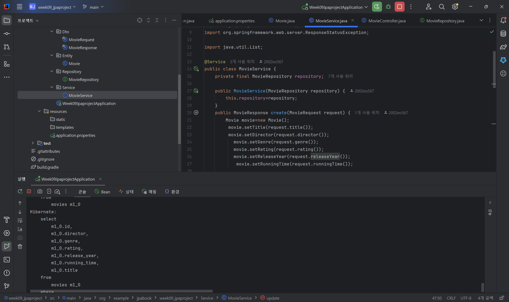

# 22200543 이어진 웹서비스 개발 01분반 9주차 과제

## 1. 프로젝트 소개
* 주제 및 주요 기능 : 영화 데이터를 다루는 CRUD program, DBeaver가 아닌 JPA를 이용해서 DB CRUD 구현

* Entity 필드 구조 : 
\- id - Long 타입 : 영화 번호 지정 (프라이머리 키)
\- title - String 타입 : 	영화 제목
\- director - String 타입 : 감독
\- genre - String 타입 : 장르
\- rating - Double 타입 : 영화 평점
\- releaseYear - Integer 타입 : 개봉 연도
\- runningTime - Integer 타입 : 상영 시간

* 프로젝트 구조 및 개발 환경 :

src/main/java/org/example/jpamovie/week09_jpaproject
├── Week09JpaprojectApplication.java
├── Entity/Movie.java
├── Repository/MovieRepository.java
├── Service/MovieService.java
├── Controller/MovieController.java
└── Dto/MovieRequest.java, MovieResponse.java

\- Java JDK 23, Spring Boot 4.1.2,Gradle
\- Spring Data JPA, Hibernate, MariaDB
\- IntelliJ IDEA, DBeaver, Postman
\- GitHub, Docker, Render

* Github Repository URL : https://github.com/eojinleecode/22200543-assign09

* Render Deployment URL : https://two2200543-assign09.onrender.com/api/movies

## 2. Database SQL Practice
* spl 연습 결과 (movie_sql)

.png)
1. 테이블 생성

.png)
2. 값 추가

.png)
3. 값 수정

.png)
4. 값 삭제 

.png)
5. 테이블 조회

## 3. Spring Data JPA 구현
* Entity 및 JpaRepository 설명 : Movie.java는 영화 정보를 저장하는 클래스, @Entity와
  @Table(name = "movies")를 통해 데이터베이스의 movies 테이블과 연결
* 사용한 Annotation의 역할 :
\- @Table- MariaDB 테이블 이름 지명
\- @Entity- JPA Entity로 고정
\- @Id- 기본 키
\- @RestController- rest api 요청 처리
\- @Valid- 요청 데이터 유효성 검사
\- @Service- 서비스 클래스 지정
\- @GeneratedValue- 기본 키 자동 생성

* REST API Endpoint 목록 및 요청응답 JSON :
\- 접근 방법 {api/movies/{id}} or {api/movies/}
.png)
.png)
.png)
.png)
* JPA Entity와 MariaDB Table 비교 :

## 4. JPA , SQL 비교

* save(), findAll(), findById(), deleteById() 사용 결과 : 
* 실제 Hibernate SQL 확인

* SQL을 직접 작성하는 방식과 JPA 방식의 차이 : 

## 5. 배포 및 환경 설정

* IntelliJ 및 Render 환경변수 설정 방법(변수명만 기록) : DB_URL ,DB_USERNAME ,DB_PASSWORD
  에다 제공 받은 개인 DB 정보를 대입시키면 된다, 개인정보를 위해 (가리기 위해) 존재한다고 생각하고 있습니다.

* Render 배포 과정 : Docker file 작성 -> Render site 접속 -> github 개인 레포지터리 연결 -> 로딩 대기 -> 배포 사이트/api/movies(제가 만든 DB name)로 들어가서 결과 확인 -> json 형식의 key,value 값들이 나열되어 있으면 정상

* 배포 URL의 CRUD 테스트 결과 :

.png)
1. 값 추가

.png)
2. 값 수정

.png)
3. 전체 조회

.png)
4. 값 삭제

* MariaDB 데이터 저장 확인 : MariaDB에서 하단에 있는 Refresh(새로고침)을 누르면 데이터의 저장,수정,조회,삭제 등 결과를 알 수 있다.

* 발생한 문제와 해결 방법  : Docker file을 생성하지 않고 배포를 했더니 무한로딩에 걸렸습니다, 따라서 IntelliJ에서 docker init 커맨드를 통해 
  기본적인 Docker file(뼈대)을 만들고 그 안에 세부사항을 수정하였습니다.  

## 6. Weekly Report

* Key Learning: 
1. 직접 SQL 쿼리문을 작성하지 않아도 Jpa를 이용해 데이터를 저장하고 수정할 수 있다는 점을 배웠습니다.
2. DTO 기능 이분화, Entity 직접 전달하지 않고 생성 및 반환 관점에서(request and response)을 DTO의 역할을 나눠서 구현할 수 있다는 점을 배웠습니다.
3. Render를 비롯한 여러 배포사이트를 통해 site를 배포하면 , 데이터를 파일처럼 영구 저장에 있어서 편리하다는 점을 배웠습니다.

* Problem & Solution: Docker file 미작성으로 인한 배포 오류 ,  command "docker init" 및 도커파일 수정으로 해결 완료. 

* Code Review: **public interface MovieRepository
  extends JpaRepository<Movie, Long> { }**

 \- MovieRepository는 JPA에서 제공하는 JpaRepository 인터페이스를 상속
 \- JpaRepository를 상속하면 직접 Sql 쿼리문들을 작성하지 않아도 다음 메서드를 사용이 가능해짐

* AI Usage: AI 활용 내용 및 직접 수정·검증한 부분, 자신이 생각하는 AI사용률(%):

\- 30 ~35 % 
\- 전체 프로젝트의 DTO의 전반적 기능, 개념 설명 요청
\- service 구현 중 존재하지 않는 ID에 대한 오류 처리부분 코드 제시 요청
\- Dockerfile 수정 및 Render 배포 과정의 문제 해결
\- IntelliJ에서 Hibernate SQL 확인하는 방법 모색 

* Reflection: Sql의 더 세밀한 문법, 그리고  혹시 JPA말고도 테이블을 더쉽게 다루는 테크닉이 있다면 알고 싶습니다. 그리고 
  Docker에 대한 전반적인 이해를 향상시키고 싶다는 생각을 했습니다.
